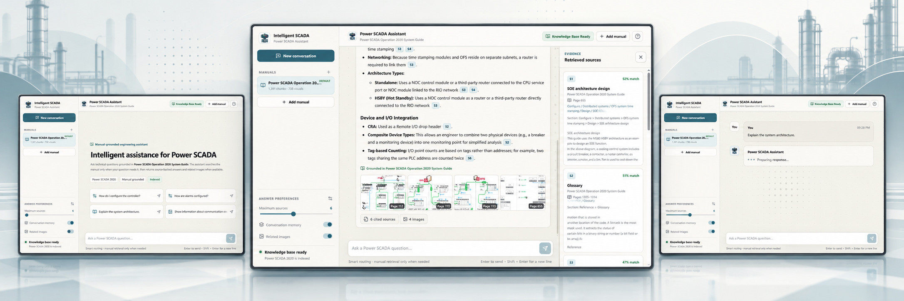
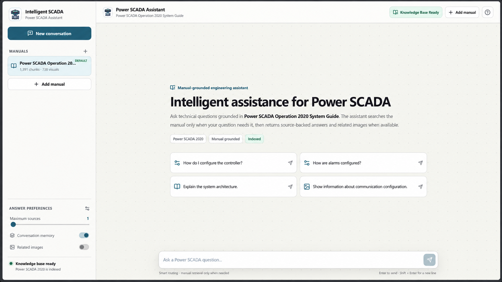
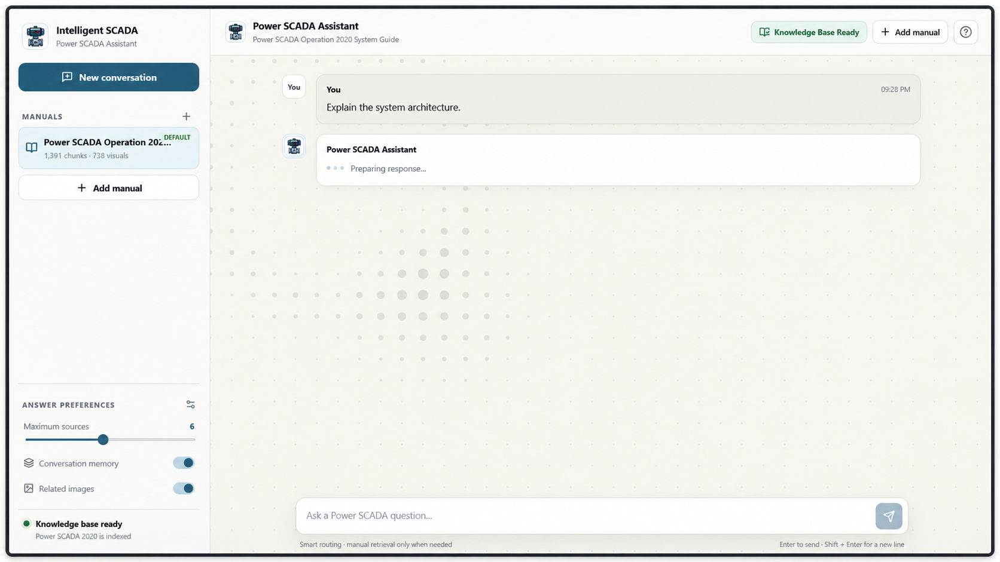
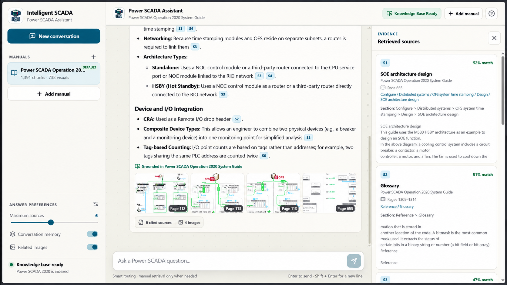
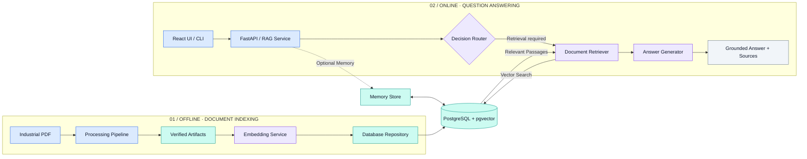
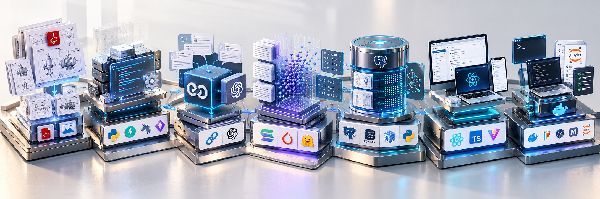
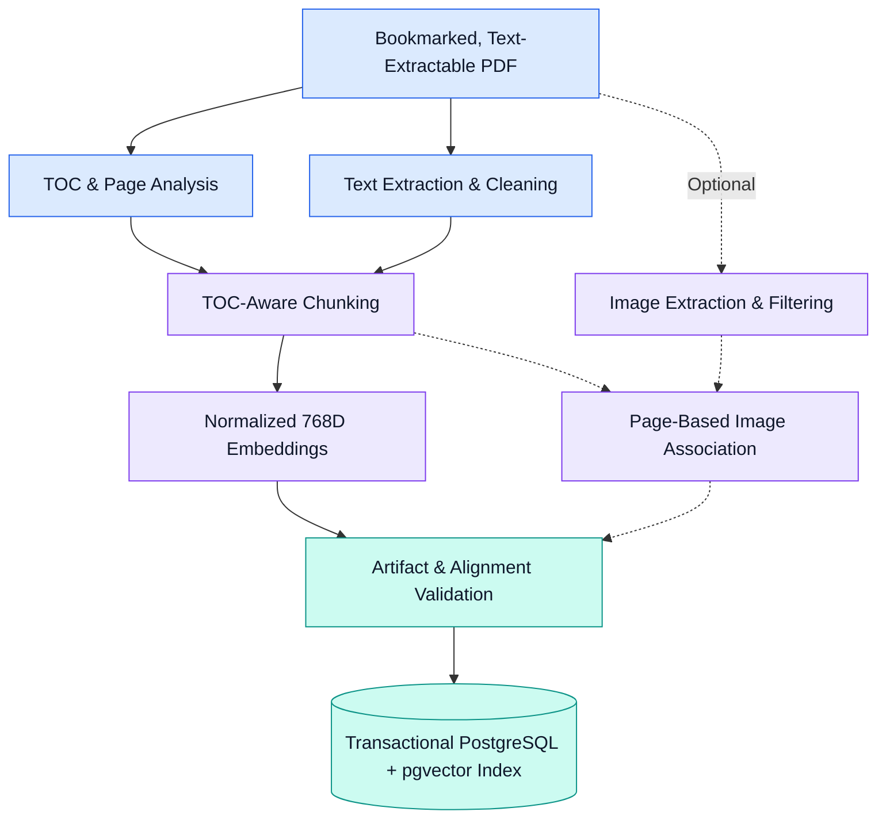
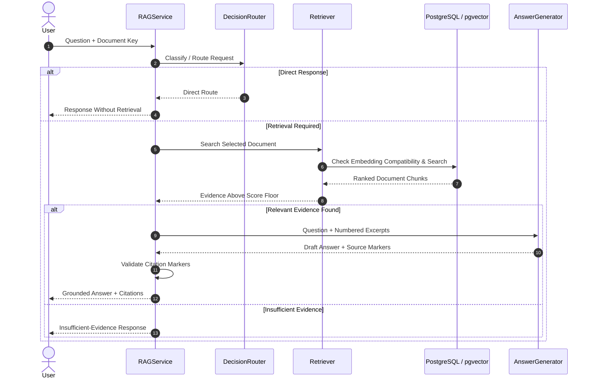
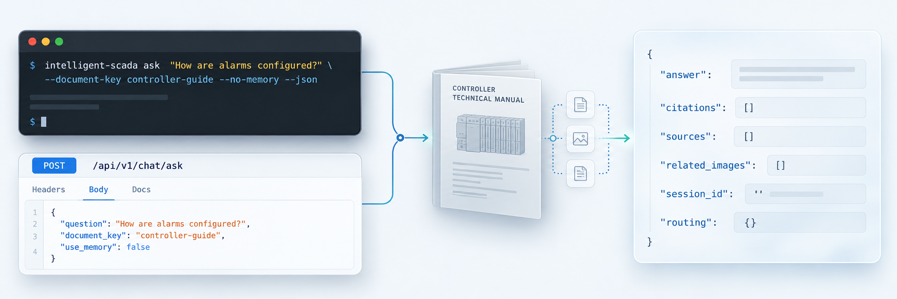
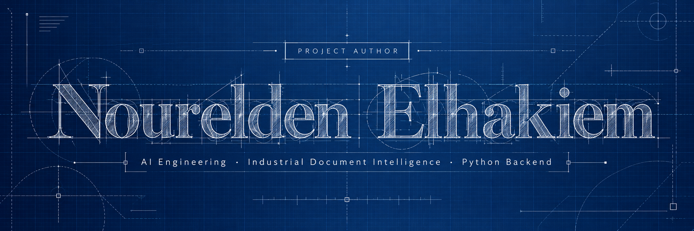

<div align="center">
  
</div>

<br>

---

## 01 · Overview & Problem Statement

<div align="center">

<h3>From Industrial Documentation to Intelligent Knowledge</h3>

<strong>Complex manuals. Smarter retrieval. Traceable answers.</strong>

<br><br>

Transforming industrial technical documentation into
<strong>searchable, document-grounded engineering knowledge</strong>
through Retrieval-Augmented Generation (RAG).

<br><br>


<sub>From complex industrial documentation to intelligent, evidence-grounded answers.</sub>

</div>

<br>

### The Challenge → The Engineering Response

<table>
  <tr>
    <th width="50%" align="left">The Challenge</th>
    <th width="50%" align="left">The Engineering Response</th>
  </tr>
  <tr>
    <td>
      <strong>Complex Technical Manuals</strong><br>
      Extensive PDFs, nested chapters, and scattered engineering information.
    </td>
    <td>
      <strong>Structure-Aware Processing</strong><br>
      Text extraction, TOC-aware sections, and ordered document chunks.
    </td>
  </tr>
  <tr>
    <td>
      <strong>Limited Keyword Search</strong><br>
      Relevant information hidden behind specialized terminology.
    </td>
    <td>
      <strong>Semantic Retrieval</strong><br>
      Normalized embeddings and PostgreSQL/pgvector cosine similarity.
    </td>
  </tr>
  <tr>
    <td>
      <strong>Evidence Traceability</strong><br>
      Technical answers require identifiable supporting sources.
    </td>
    <td>
      <strong>Source-Grounded Answers</strong><br>
      Retrieved excerpts, page metadata, and traceable citations.
    </td>
  </tr>
  <tr>
    <td>
      <strong>Repeated Processing Overhead</strong><br>
      Reprocessing unchanged documents wastes resources.
    </td>
    <td>
      <strong>Resumable Ingestion</strong><br>
      SHA-256-checked artifacts and reusable processing stages.
    </td>
  </tr>
</table>

<br>

<div align="center">

<strong>PDF DOCUMENTS → STRUCTURED KNOWLEDGE → SEMANTIC RETRIEVAL → GROUNDED ANSWERS</strong>

<br>

<sub>Industrial Document Intelligence · RAG · Evidence-Based Question Answering</sub>

</div>

<br>

> [!NOTE]
> **Engineering scope:** This is an industrial document-intelligence
> assistant, not a live SCADA monitoring or PLC control system.
> Safety-critical answers require verification against official manuals.

---

## 02 · Key Features

<div align="center">

<h3>Engineering Intelligence, Built Around Real Documentation</h3>

<strong>Structured ingestion · Semantic retrieval · Verifiable evidence</strong>

<br><br>

A modular industrial knowledge system combining document processing,
vector search, grounded AI answers, and reliable ingestion workflows.

<br><br>


<sub>Document intelligence · Retrieval engineering · Evidence-grounded AI</sub>

</div>

<br>

### Core Capabilities

<table>
  <tr>
    <th colspan="2" align="left">01 / DOCUMENT INTELLIGENCE</th>
  </tr>
  <tr>
    <td width="35%"><strong>PDF Processing</strong></td>
    <td>Page-text extraction, bookmark structure, and document-noise cleanup.</td>
  </tr>
  <tr>
    <td><strong>TOC-Aware Chunking</strong></td>
    <td>Section-aware chunks with stable ordering and source-page metadata.</td>
  </tr>
  <tr>
    <td><strong>Visual Evidence</strong></td>
    <td>Optional extraction, filtering, and association of technical figures.</td>
  </tr>
  <tr>
    <th colspan="2" align="left">02 / SEMANTIC AI & RETRIEVAL</th>
  </tr>
  <tr>
    <td><strong>Text Embeddings</strong></td>
    <td>Sentence Transformers / MPNet with normalized 768-dimensional vectors.</td>
  </tr>
  <tr>
    <td><strong>Semantic Search</strong></td>
    <td>Document-scoped cosine similarity using PostgreSQL + pgvector.</td>
  </tr>
  <tr>
    <td><strong>Grounded Answers</strong></td>
    <td>OpenAI-compatible generation using retrieved evidence and validated [S#] source markers.</td>
  </tr>
  <tr>
    <td><strong>Intelligent Routing</strong></td>
    <td>Deterministic handling of clear requests; optional LLM classification for ambiguous queries.</td>
  </tr>
  <tr>
    <td><strong>Conversation Memory</strong></td>
    <td>Optional document-scoped sessions and summarization, with explicit memory-off behavior.</td>
  </tr>
  <tr>
    <th colspan="2" align="left">03 / RELIABILITY & APPLICATION</th>
  </tr>
  <tr>
    <td><strong>Resumable Ingestion</strong></td>
    <td>Stage reuse validated against source, configuration, dependency, and output hashes.</td>
  </tr>
  <tr>
    <td><strong>Application Interfaces</strong></td>
    <td>FastAPI HTTP API, Python CLI, and React UI when its build is available.</td>
  </tr>
</table>

<br>

<details>
<summary><strong>Engineering Safeguards & Limitations</strong></summary>

<br>

| Area | Engineering Detail |
|:---|:---|
| **Data isolation** | Document keys scope chunks, images, and conversation records. |
| **Transactional writes** | Failed SQL replacements roll back without partially replacing the prior index. |
| **Embedding integrity** | Model identity and vector dimensions are checked before retrieval. |
| **Citation validation** | Unknown markers are rejected; valid citations do not guarantee factual accuracy. |
| **Execution model** | Process-local API jobs; intended for one API process and one ingestion worker. |
| **Current limitations** | No built-in authentication, OCR, or fallback chunking without usable TOC bookmarks. |

</details>

<br>

---

## 03 · Application Screenshots

<div align="center">

<h3>Intelligent SCADA Assistant in Action</h3>

<strong>Real Application · Technical Assistance · Source Evidence</strong>

<br><br>

Explore the application interface, document workspace,
technical question answering, and evidence-backed responses.

<br><br>



<sub>Real interface · Industrial documentation · Traceable evidence</sub>

</div>

<br>

### Application Gallery

<table>
  <tr>
    <td width="50%" align="center" valign="top">
      
      <br>
      <strong>01 · Document Workspace</strong>
      <br>
      <sub>Manage manuals and explore suggested technical questions.</sub>
    </td>
    <td width="50%" align="center" valign="top">
      
      <br>
      <strong>02 · AI Assistant</strong>
      <br>
      <sub>Submit technical questions against an indexed manual.</sub>
    </td>
  </tr>
  <tr>
    <td colspan="2" align="center" valign="top">
      
      <br>
      <strong>03 · Sources & Visual References</strong>
      <br>
      <sub>Inspect retrieved evidence, source pages, and associated figures.</sub>
    </td>
  </tr>
</table>

<br>

---

## 04 · System Architecture

<div align="center">

<h3>From Document Processing to Intelligent Retrieval</h3>

<strong>Modular Architecture · Document-Scoped Knowledge · Grounded AI</strong>

<br><br>

Two complementary execution paths connect
<strong>offline document indexing</strong> with
<strong>online technical question answering</strong>.

<br><br>


<sub>Document processing · Knowledge storage · Intelligent retrieval</sub>

</div>

<br>

### Architecture & Data Flow



<br>

### Architectural Components

| Layer | Core Components | Responsibility |
|:---|:---|:---|
| **Interfaces** | React UI, [FastAPI](src/intelligent_scada/api/), [CLI](src/intelligent_scada/cli.py) | Manage manuals and access the assistant. |
| **Processing** | [Pipeline](src/intelligent_scada/pipeline.py), [ingestion](src/intelligent_scada/ingestion/), [chunking](src/intelligent_scada/chunking/) | Extract, structure, and validate document artifacts. |
| **Knowledge Index** | [Embeddings](src/intelligent_scada/embeddings/), [database](src/intelligent_scada/database/) | Persist document-scoped chunks, vectors, and images. |
| **Intelligence** | [Router](src/intelligent_scada/router/), [retrieval](src/intelligent_scada/retrieval/), [RAG](src/intelligent_scada/rag/) | Route queries, retrieve evidence, and generate answers. |
| **Context** | [Memory](src/intelligent_scada/memory/), [image lookup](src/intelligent_scada/images/) | Optional conversation context and related figures. |

<br>

<div align="center">

<sub>
For implementation details, contracts, and failure behavior,
see the <a href="docs/architecture.md">Architecture Documentation</a>.
</sub>

</div>

---

## 05 · Technology Stack

<div align="center">

<h3>Built with a Modern AI Engineering Stack</h3>

<strong>Python · FastAPI · PostgreSQL · pgvector · React</strong>

<br><br>

A modular technology stack connecting document processing,
semantic AI, backend services, and application interfaces.

<br><br>



<sub>Backend Engineering · AI & Retrieval · Data Infrastructure · Web Application</sub>

</div>

<br>

### Core Technologies

| Engineering Layer | Technologies | Responsibility |
|:---|:---|:---|
| **Backend & API** | Python 3.11–3.13 · FastAPI · Uvicorn · Pydantic | Validated API, CLI, and application services |
| **LLM Orchestration** | LangChain Core · OpenAI-compatible HTTP endpoint | Context assembly and model calls |
| **Embedding Models** | Sentence Transformers · MPNet · PyTorch · Hugging Face Hub | Normalized text embeddings and model identity |
| **Vector Database** | PostgreSQL 16 · pgvector · psycopg2 · NumPy | HNSW cosine search and document-scoped storage |
| **Document Processing** | PyMuPDF · Pillow | PDF extraction, document structure, and visual evidence |
| **Frontend** | React · TypeScript · Vite | Interactive browser application |
| **DevOps & Quality** | Docker Compose · pytest · Ruff · mypy · JupyterLab | Local deployment, validation, and research workflows |

<br>

<details>
<summary><strong>Implementation References</strong></summary>

<br>

| Resource | Reference |
|:---|:---|
| **Python dependencies** | [pyproject.toml](pyproject.toml) |
| **Container configuration** | [Docker Compose](docker-compose.yml) |
| **Database schema** | [database/schema.sql](database/schema.sql) |
| **Research notebooks** | [8 Research Notebooks](notebooks/README.md) |
| **Development & validation** | [Development Guide](docs/development.md) |

</details>

---

## 06 · AI / ML Pipeline

<div align="center">

<h3>From Raw Documents to Evidence-Grounded Intelligence</h3>

<strong>Document Ingestion · Vector Embeddings · Semantic Retrieval · RAG</strong>

<br><br>

A two-stage AI pipeline that transforms industrial manuals
into searchable knowledge and generates technical answers
supported by retrieved source evidence.

<br><br>


<sub>Offline Knowledge Indexing · Online Evidence-Grounded Question Answering</sub>

</div>

<br>

### A · Offline Pipeline — Building the Knowledge Index

Extract, structure, embed, and index technical documentation
through a reproducible processing workflow.



**Pipeline reliability**

- **Resumable stages:** `--resume` reuses artifacts only when their validation conditions remain satisfied.
- **Artifact integrity:** Input fingerprints, dependency settings, and SHA-256 output hashes are tracked.
- **Index consistency:** Ordered chunk metadata, vector alignment, and embedding-model identity are checked before indexing.

<br>

### B · Online Pipeline — Answering from Evidence

User requests pass through intelligent routing, document-scoped
retrieval, and source-grounded answer generation.



<br>

### Pipeline Design Principles

| Principle | Implementation |
|:---|:---|
| **Document Isolation** | Retrieval stays within the selected manual. |
| **Embedding Compatibility** | Model identity and vector dimensions are checked. |
| **Evidence Grounding** | Answer generation uses selected source excerpts. |
| **Citation Validation** | Source markers are checked against retrieved evidence. |
| **Optional Context** | Memory and related images can enrich responses. |
| **Controlled Fallback** | Insufficient evidence produces an explicit response. |

<br>

---

## 07 · Installation & Quick Start

<div align="center">

<h3>From Repository to Running Application</h3>

<strong>Local Setup · Document Indexing · Technical Question Answering</strong>

<br><br>

Get started with the Python backend and CLI,
or launch the full web application with Docker Compose.

<br><br>


<sub>Python Environment · PostgreSQL + pgvector · CLI · Docker Compose</sub>

</div>

<br>

### Prerequisites

| Requirement | Version / Notes |
|:---|:---|
| **Python** | 3.11–3.13 |
| **Git** | Repository access |
| **PostgreSQL** | Version 16 with pgvector |
| **Docker + Compose** | Local database and containerized deployment |
| **Node.js** | 20+ for building the React frontend |
| **GPU** | Optional; CPU inference is supported |

> [!NOTE]
> The first embedding run requires downloading the configured
> Sentence Transformers model. Use a bookmarked, text-extractable
> PDF that you are authorized to process.

<br>

### Option A · Windows / PowerShell

**01 / Create the Python environment**

Run from the repository root:

```powershell
py -3.12 -m venv .venv
.\.venv\Scripts\Activate.ps1
python -m pip install -e ".[dev]"
Copy-Item .env.example .env
```

**02 / Configure environment variables**

Edit `.env` and configure:

| Variable | Configuration |
|:---|:---|
| `POSTGRES_PASSWORD` | Private, non-placeholder database password |
| `PG_CONN_STR` | PostgreSQL connection via `127.0.0.1:5433` |
| `SCADA_ANSWER_BASE_URL` | Compatible model-provider endpoint |
| `SCADA_ANSWER_API_KEY` | Provider API key |
| `SCADA_ANSWER_MODEL` | Selected answer model |

> [!IMPORTANT]
> Keep `.env`, passwords, and API keys out of version control.

**03 / Start PostgreSQL and initialize the database**

```powershell
docker compose up -d postgres
intelligent-scada init-db
```

**04 / Ingest an industrial PDF manual**

```powershell
intelligent-scada --data-dir data/documents/controller-guide ingest "C:\manuals\controller-guide.pdf" --document-name "Controller Guide" --document-key controller-guide --resume
```

**05 / Ask your first technical question**

```powershell
intelligent-scada ask "How are alarms configured?" --document-key controller-guide --no-memory
```

<br>

### Option B · Full Web Application

When the frontend source and required build files are present:

```powershell
docker compose up --build
```

| Service | Local Address |
|:---|:---|
| **Web Application** | http://127.0.0.1:8000 |
| **API Documentation** | http://127.0.0.1:8000/api/docs |

<br>

<details>
<summary><strong>Developer Commands & Validation</strong></summary>

<br>

**Run the local backend**

```powershell
intelligent-scada serve
```

**Execute development checks**

```powershell
pytest
ruff check .
mypy
```

Database-marked tests require a separate disposable
PostgreSQL/pgvector test database configured through
`TEST_PG_CONN_STR`.

</details>

<br>

**Further documentation:**
[Development Guide](docs/development.md) ·
[Configuration Reference](docs/configuration.md)

---

## 08 · Example Usage

<div align="center">

<h3>Ask Questions. Retrieve Evidence. Explore Answers.</h3>

<strong>Python CLI · FastAPI · Document-Grounded Responses</strong>

<br><br>

Interact with an indexed industrial manual through
the command-line interface or the HTTP API.

<br><br>



<sub>Technical Question → Document-Scoped Retrieval → Evidence-Grounded Response</sub>

</div>

<br>

### Example A · Python CLI

**Question:** **How are alarms configured?**

Query a previously indexed industrial manual:

```powershell
intelligent-scada ask "How are alarms configured?" --document-key controller-guide --no-memory --json
```

**JSON Response Structure**

```json
{
  "answer": "<answer text or insufficient-evidence message>",
  "citations": [],
  "sources": [],
  "related_images": [],
  "session_id": null,
  "routing": {}
}
```

<br>

### Example B · FastAPI HTTP Request

Send a technical question to the application API:

```powershell
$payload = @{
    question = "How are alarms configured?"
    document_key = "controller-guide"
    memory_enabled = $false
} | ConvertTo-Json

Invoke-RestMethod `
    -Uri "http://127.0.0.1:8000/api/v1/chat/ask" `
    -Method Post `
    -ContentType "application/json" `
    -Body $payload
```

**Endpoint:** `POST /api/v1/chat/ask`

**API Documentation:**
[Interactive Swagger UI](http://127.0.0.1:8000/api/docs)

<br>

### Implementation References

| Resource | Source |
|:---|:---|
| **CLI commands** | [Python CLI](src/intelligent_scada/cli.py) |
| **HTTP endpoints** | [API Routes](src/intelligent_scada/api/routes.py) |
| **Request/response models** | [API Schemas](src/intelligent_scada/api/schemas.py) |

<br>

> [!IMPORTANT]
> **Grounded responses:** Retrieved passages support technical
> answers, but citation validation does not independently
> establish factual correctness.

---

## 09 · Author

<div align="center">



<br><br>

<h3>Thank You for Reading!</h3>


<br><br>

<strong>Let's Connect!</strong>

<br><br>

<a href="https://www.linkedin.com/in/noureldenelhakiem/">
  
</a>

<br><br>


</div>
