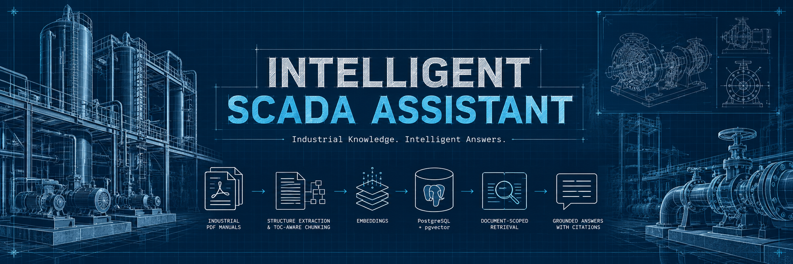
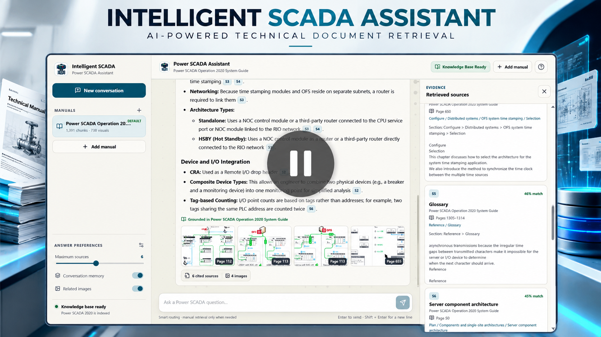
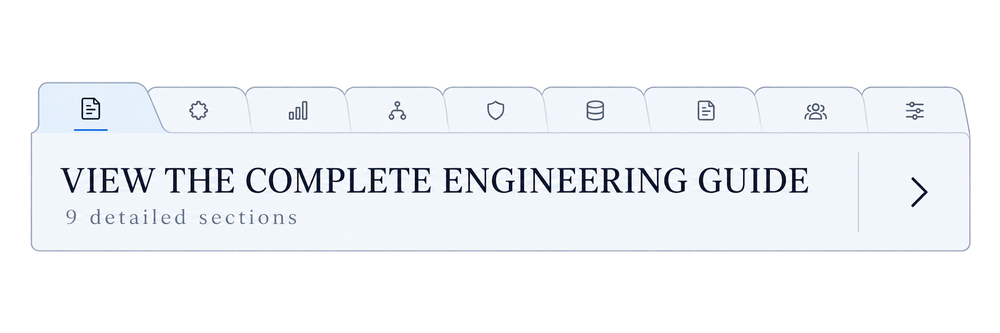

  

    
  

  <h1>
    <picture>
      <source
        media="(prefers-color-scheme: dark)"
        srcset="assets/branding/titles/intelligent-scada-title-montserrat-dark.svg"
      />
      
    </picture>
  </h1>

  

    <strong>
      Transform industrial technical manuals into searchable knowledge
      and source-grounded AI answers.
    </strong>
  

  

    
      INDUSTRIAL DOCUMENT INTELLIGENCE ·
      RETRIEVAL-AUGMENTED GENERATION ·
      PYTHON ENGINEERING
    
  

  

    
  

  

    
    
    
    
    
  

  <h3>Core Technology Stack</h3>

  

    
  

  

    
  

  <h3>Core Capabilities</h3>

  

    
    
    
    
    
    
    
  

  

    <a href="docs/architecture.md">Architecture</a> ·
    <a href="docs/development.md">Development</a> ·
    <a href="docs/configuration.md">Configuration</a> ·
    <a href="tests/README.md">Tests</a>
  

---

<h2 align="center">Project in Action</h2>

  
    Explore the architecture and see the AI assistant in action.
  

<h3 align="center">01 · System Overview</h3>

  

  
    PDF Ingestion → Embeddings → pgvector → RAG Answers
  

<h3 align="center">02 · AI Assistant Demonstration</h3>

  

  <a href="https://youtu.be/aVRDoR3s1Uo">
    <strong>▶ Watch the Full Demonstration</strong>
  </a>

---

  

---
