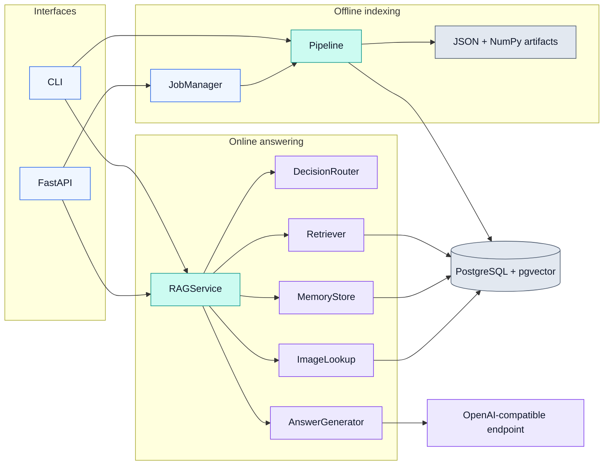
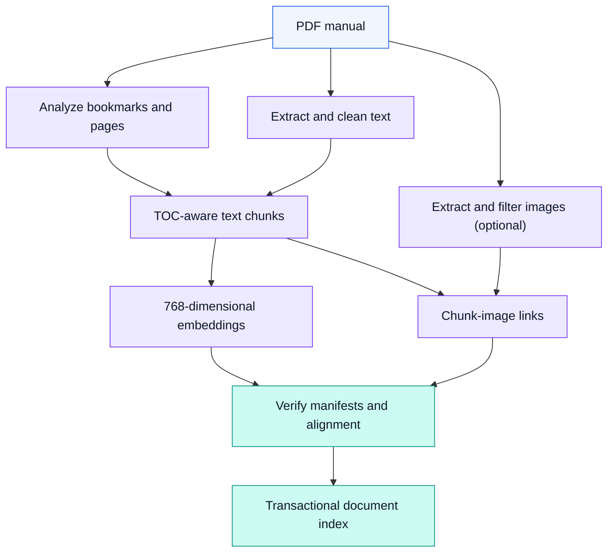
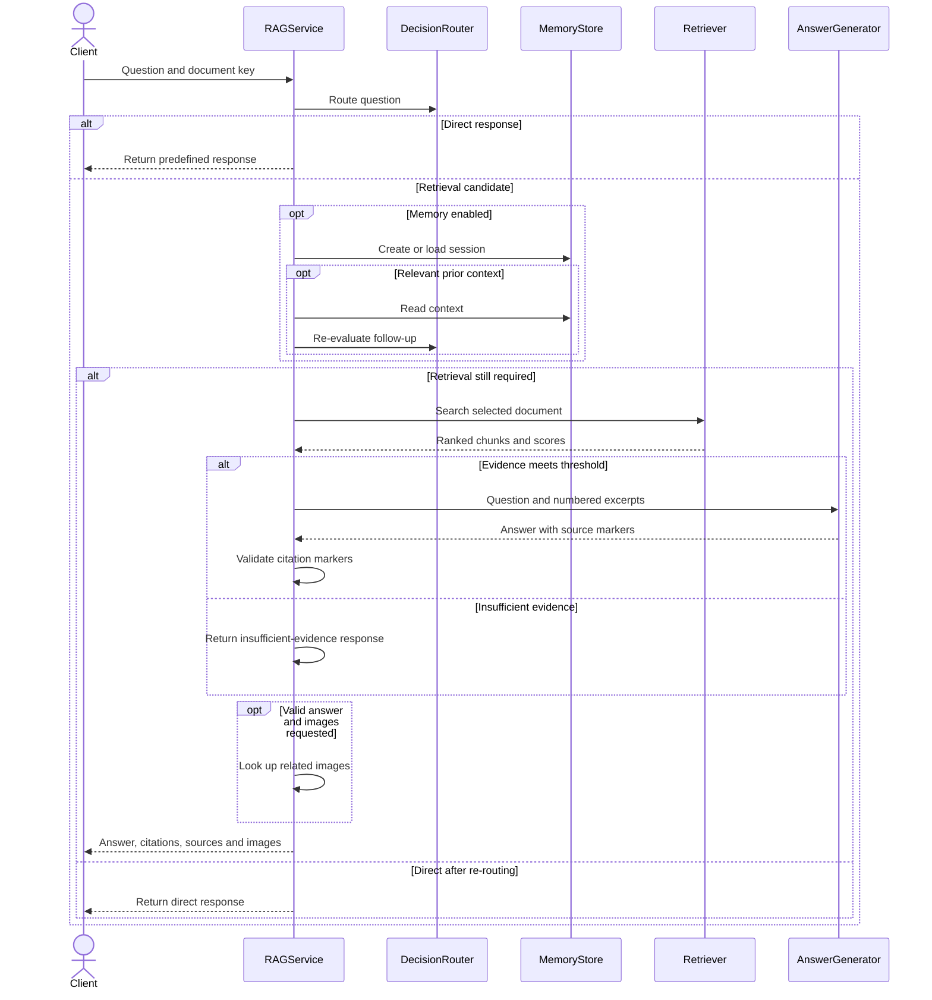

<div align="center">

# Intelligent SCADA Assistant

**Source architecture · PDF knowledge ingestion and document-grounded assistance**


[Architecture](#architecture) · [Ingestion](#ingestion-workflow) · [Question answering](#query-workflow) · [Source map](#source-map) · [Package READMEs](#package-readmes) · [Constraints](#engineering-constraints)

</div>

---

`intelligent_scada` turns **text-extractable, bookmarked PDF manuals** into searchable, document-scoped knowledge. [`Pipeline`](pipeline.py) creates and verifies intermediate artifacts before indexing; [`RAGService`](rag/service.py) combines routing, retrieval, optional conversational context and grounded answer generation for the CLI and FastAPI interfaces.

> [!NOTE]
> This is an **offline document-indexing / online question-answering** system. It does **not** read live SCADA telemetry, control industrial equipment or execute operational commands.

## Architecture



**Two execution paths:** preprocessing and database writes happen during indexing; request-time retrieval and generation read the index. API ingestion delegates to the same [`Pipeline`](pipeline.py) via [`JobManager`](api/jobs.py), rather than implementing a second pipeline.

## Ingestion workflow



The pipeline fingerprints stage inputs and records output **SHA-256** hashes. [`stage_matches()`](artifacts.py) permits `--resume` to reuse a stage only when its manifest version, inputs, required outputs and recorded file hashes agree. [`Pipeline.index()`](pipeline.py) performs a separate provenance check across structure, text, chunks, optional image/link data, embedding metadata and model identity before writing to PostgreSQL.

Embedding artifacts are stored as `float32` `.npy` vectors, ordered chunk metadata and a run manifest. `--force` rebuilds pipeline stages; `--skip-index` produces artifacts without persisting them to the database.

## Query workflow



The router answers recognized nontechnical messages without a retrieval or model call; an **optional LLM router** can classify ambiguous questions (`router_enabled=False` by default). For technical queries, [`Retriever`](retrieval/README.md) checks the indexed embedding identity and dimension before document-scoped pgvector cosine search. [`RAGService.ask()`](rag/service.py) filters low-score results and can use session context or attach related images when appropriate.

Citation checking rejects unknown `[S#]` markers. It **does not** prove that every statement is supported by the cited excerpt; when evidence is insufficient, the service returns a limitation message instead of generating an answer.

## Engineering constraints

| Boundary | Actual safeguard or limitation |
|---|---|
| **Artifact reproducibility** | Versioned SHA-256 manifests and index-time alignment checks protect against stale intermediate data. |
| **Document isolation** | Database rows and vector search are scoped by `document_key`; uploaded artifacts are separated under `data/documents/<key>/`. |
| **Model compatibility** | A fixed `VECTOR(768)` schema requires compatible embeddings; retrieval rejects incompatible indexed model identity or dimensions. |
| **Runtime state** | In-process API jobs are not durable across restarts; configuration requires one API worker and one ingestion worker. |
| **Grounding** | Source-marker validation is syntactic, not a factual entailment or industrial-safety guarantee. |

## Source map

| Root module | Main interfaces | Purpose |
|---|---|---|
| [`pipeline.py`](pipeline.py) | `Pipeline.ingest()`, `index()`, `embed()` | Stage orchestration, resumption and indexing checks |
| [`artifacts.py`](artifacts.py) | `stage_matches()`, `write_stage_manifest()`, `save_embeddings()` | Atomic files and provenance hashes |
| [`config.py`](config.py) | `Settings.from_env()`, `validate()`, `for_document()` | Configuration, path ownership and limits |
| [`contracts.py`](contracts.py) | `TextChunk`, `PdfStructure`, `RetrievalResult`, `AnswerResponse` | Typed cross-package data contracts |
| [`cli.py`](cli.py) | `main()`, `run()` | Stage commands, document operations and API startup |
| [`logging_config.py`](logging_config.py) | `configure_logging()`, `get_logger()` | Shared application logging |
| [`__init__.py`](__init__.py) | `Settings`, `get_settings`, `__version__` | Public package exports |

`py.typed` marks the package as distributing typing information.

## Package READMEs

**Explore the implementation by responsibility.** Each package README explains its source files, core functions, internal workflow, integration points and operational limits. These links resolve relative to this file at `src/intelligent_scada/README.md`.

### 01 · Build the knowledge index

| Package documentation | Implementation focus |
|---|---|
| **[Ingestion →](ingestion/README.md)** | PDF bookmarks and page text, cleanup, embedded-image extraction and filtering |
| **[Chunking →](chunking/README.md)** | TOC-driven sections, chunk boundaries, metadata and page lineage |
| **[Embeddings →](embeddings/README.md)** | SentenceTransformer encoding, normalized vectors and model provenance |
| **[Linking →](linking/README.md)** | Deterministic chunk-to-image associations by source-page overlap |

### 02 · Persist and retrieve evidence

| Package documentation | Implementation focus |
|---|---|
| **[Database →](database/README.md)** | PostgreSQL/pgvector schema, document isolation, transactions and migrations |
| **[Retrieval →](retrieval/README.md)** | Document-scoped cosine search and embedding compatibility checks |
| **[Images →](images/README.md)** | Related-image lookup and safe stored-path resolution |

### 03 · Serve questions and generate answers

| Package documentation | Implementation focus |
|---|---|
| **[API →](api/README.md)** | FastAPI endpoints, validation, upload handling and in-process ingestion jobs |
| **[Router →](router/README.md)** | Deterministic request classification and optional model-assisted routing |
| **[RAG →](rag/README.md)** | Retrieval orchestration, evidence prompts, answer generation and source markers |
| **[Memory →](memory/README.md)** | Document-scoped chat sessions, persistence and contextual summaries |

<details>
<summary><strong>View complete source README directory</strong></summary>

```text
src/
└── intelligent_scada/
    ├── README.md                  ← You are here
    ├── api/README.md
    ├── chunking/README.md
    ├── database/README.md
    ├── embeddings/README.md
    ├── images/README.md
    ├── ingestion/README.md
    ├── linking/README.md
    ├── memory/README.md
    ├── rag/README.md
    ├── retrieval/README.md
    └── router/README.md
```

</details>

<details>
<summary><strong>CLI commands and artifact ownership</strong></summary>

The [`cli.py`](cli.py) entry point exposes `ingest`, `extract-images`, `analyze-pdf`, `extract-text`, `chunk`, `link-images`, `embed`, `init-db`, `index`, `ask`, `delete-document` and `serve`.

CLI preprocessing uses the configured `data_dir`; use separate artifact directories when concurrently processing different manuals. The `chunk --output` override can write an experimental export outside the canonical chunk artifact path; that export is not a verified input to production indexing.

</details>

> [!IMPORTANT]
> TOC-aware ingestion expects **bookmarks and extractable PDF text**; OCR is not implemented. PostgreSQL with pgvector must be provisioned separately. This architecture was checked against the uploaded `src` archive, **not** against a live database, running API, model endpoint or frontend.
