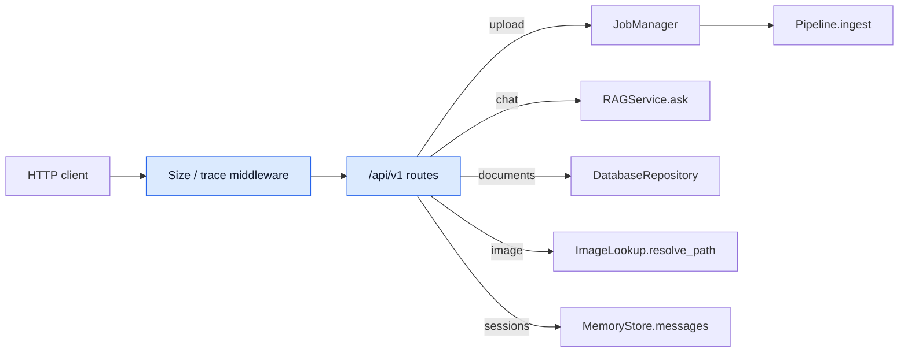
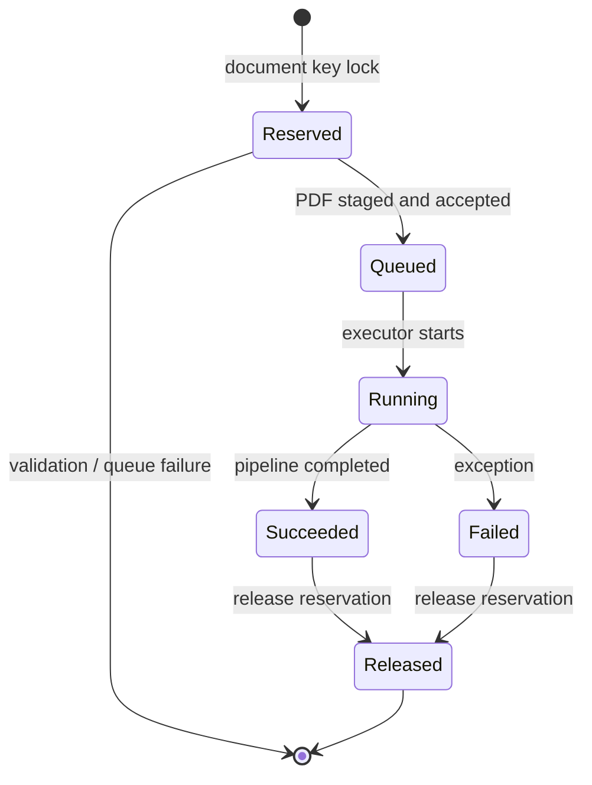

# `api` · FastAPI boundary and ingestion jobs

The API exposes document management, background ingestion, grounded chat and session readback under `/api/v1`. [`create_app()`](app.py) wires shared settings, a database repository, a lazily instantiated RAG service and an in-process [`JobManager`](jobs.py). It can also serve a built frontend SPA; frontend assets themselves are outside this archive.

## HTTP request topology

| Endpoint | Core action | Contract |
|---|---|---|
| `GET /health`, `/runtime` | Read readiness/configuration | [`HealthResponse`, `RuntimeResponse`](schemas.py) |
| `GET /documents` | List indexed documents | `DocumentListResponse` |
| `POST /documents/upload` | Stage PDF, reserve key, enqueue job; **202** | `JobResponse` |
| `GET /jobs`, `/jobs/{job_id}` | List or inspect process-local jobs | `JobListResponse`, `JobResponse` |
| `DELETE /documents/{document_key}` | Remove DB records; optionally local artifacts | `DeleteResponse` |
| `POST /chat/ask` | Execute routed document question | `AskRequest`, `AskResponse` |
| `GET /sessions/{session_id}/messages` | Load recent persisted transcript | `SessionMessagesResponse` |
| `GET /documents/{document_key}/images/{filename}` | Serve DB-authorized image | File response |

## Upload and worker lifecycle

[`upload_document()`](routes.py) checks `.pdf` extension, validates the document name/key, verifies the first bytes start with `%PDF-`, streams to a temporary file in bounded chunks and enforces the PDF byte cap. [`UploadSizeLimitMiddleware`](middleware.py) independently bounds the whole multipart body (limit plus 64 KiB overhead) before normal parsing. A successful worker atomically renames the staged PDF to its document path before invoking `Pipeline.ingest`.

`JobManager.reserve_document()` prevents parallel upload, indexing or deletion for the same key **within one process**; it also bounds accepted active/queued ingestions by the configured pending capacity. Jobs transition from `queued` to `running` to `succeeded`/`failed`; completed records are pruned by creation age. Failure responses retain a safe generic error and job ID for log correlation, not an internal stack trace.

## Files and implementation roles

| File | Important interfaces | Role |
|---|---|---|
| [`app.py`](app.py) | `create_app`, `_error` | Dependency wiring, lifespan, CORS, exception mapping and SPA fallback |
| [`routes.py`](routes.py) | `upload_document`, `ask_question`, `delete_document`, `health`, `document_image` | Endpoint orchestration and request checks |
| [`jobs.py`](jobs.py) | `JobManager`, `JobRecord`, `DocumentBusyError`, `QueueFullError` | Worker executor, reservations and job snapshots |
| [`middleware.py`](middleware.py) | `UploadSizeLimitMiddleware`, `request_context_middleware` | Ingress ceiling, request ID and security headers |
| [`schemas.py`](schemas.py) | `AskRequest`, `JobResponse`, `StrictModel` and response types | Pydantic validation; unknown fields forbidden |
| [`__init__.py`](__init__.py) | `create_app` | Public application-factory export |
