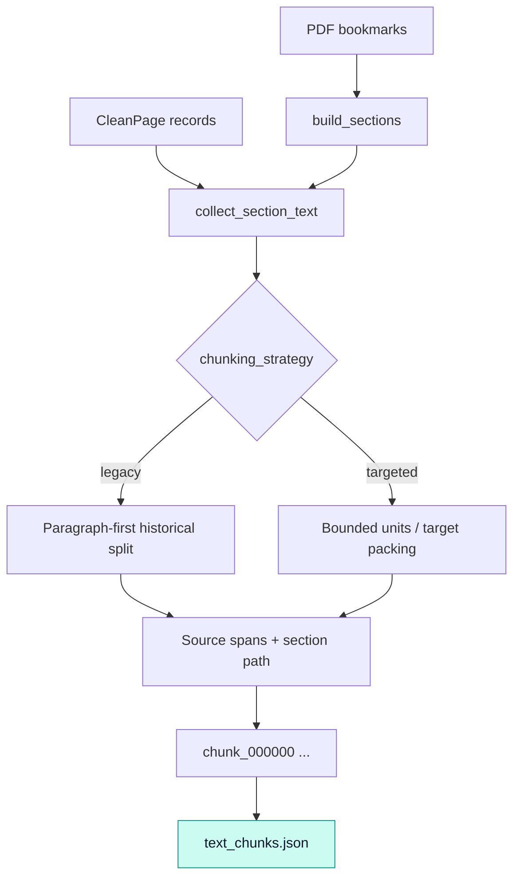

# `chunking` · TOC-aware chunk construction

This package turns the PDF bookmark hierarchy and cleaned one-based page texts into ordered `TextChunk` records. [`build_sections()`](toc_parser.py) derives page-range sections from adjacent TOC entries; [`create_chunks()`](toc_chunker.py) slices their text using the selected splitting strategy and preserves source-page lineage. It is structural/document-aware chunking, not model-inferred semantic segmentation.

## Structural flow

A TOC entry carries `level`, `title` and `page`. Section paths are assembled using a level-indexed stack. The section end page is the next bookmark's page minus one (clamped to the start) or the last PDF page; consequently nested or same-page bookmarks may share page content. Titles in `skip_sections` are dropped by exact equality, not by heading similarity.

## Splitting and page provenance

`_Part` carries both text and character-offset page spans through slicing, stripping, joining and splitting. This gives each resulting chunk its own `source_pages` rather than blindly inheriting a whole section's page range. The stored `text` starts with `Section: <hierarchy>`; `chunk_id` and `chunk_index` are sequential within **one generated document**, not globally unique across documents. Database identity therefore also includes the document ID.

The default `legacy` strategy preserves historical paragraph-splitting behavior, with overlap carried at rollover; a long unsplittable line can exceed the nominal maximum. `targeted` splits long paragraphs into fixed-size overlapping units, then prefers paragraph boundaries near the target while avoiding an oversized merged unit. Both strategies validate positive sizes, `target <= maximum` and `overlap < maximum`.

## File map

| File | Main interfaces | Contribution |
|---|---|---|
| [`toc_parser.py`](toc_parser.py) | `build_sections` | Validate TOC levels/pages and construct hierarchical ranges |
| [`toc_chunker.py`](toc_chunker.py) | `collect_section_text`, `split_section_text`, `create_chunks`, `_Part`, `_legacy_split`, `_targeted_split` | Page-aware chunk construction and selectable packing |
| [`__init__.py`](__init__.py) | `build_sections`, `create_chunks`, `split_section_text` | Public convenience exports |

**Inputs:** [`PdfStructure` and `CleanPage`](../contracts.py) created by [ingestion](../ingestion/README.md). **Output:** ordered `TextChunk` JSON saved via [`write_json()`](../artifacts.py). The [pipeline](../pipeline.py) hashes structure, page content and chunk settings before reusing chunks; [embeddings](../embeddings/README.md) consumes the output order and text.

