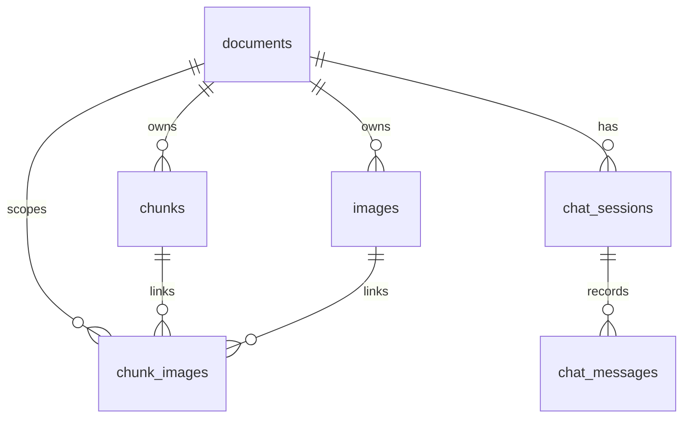
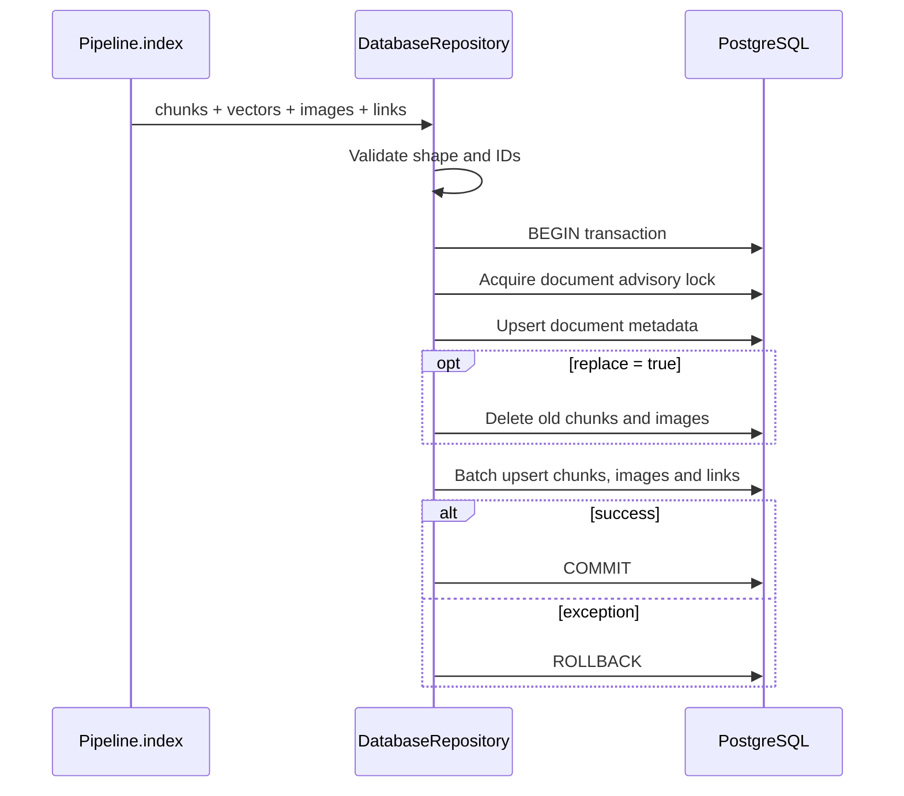

# `database` · Transactional, document-scoped persistence

This package stores indexed PDF chunks, image associations and chat memory in PostgreSQL with pgvector. [`DatabaseRepository`](repository.py) converts validated ingestion artifacts into related tables within one transaction; [`transaction()`](connection.py) owns commit, rollback and connection closing. The same relational schema supports retrieval and per-document session histories.

## Persistent relationships

[`migrations/001_initial.sql`](migrations/001_initial.sql) enables `vector`, creates seven tables and establishes document-specific uniqueness and cascade deletion. `chunks.embedding` is `VECTOR(768)` with an HNSW index using `vector_cosine_ops`; `source_pages`, `section_path` and message citations are JSONB. `chunk_images` has composite foreign keys to chunks/images in the **same document**, preventing cross-document linking at the schema level.

## Index transaction

`ingest_document()` refuses empty chunks, unrecognized vector dimensions and blank model identity. [`validate_embedding_alignment()`](models.py) checks array shape, finiteness, unique/order-consistent chunk IDs; when supplied by `Pipeline.index()`, it additionally compares ordered metadata and the embedding run manifest before DB submission. An advisory transaction lock serialized by `document_key` protects even CLI writers that bypass the API job manager.

`replace=True` removes prior chunks and images for that document and reinserts the latest set, with cascading link cleanup. `replace=False` first locks the existing document row and refuses a different PDF SHA, embedding model or dimension; this is a compatible upsert mode, not a general merge facility. `delete_document()` relies on DB cascades for indexed data, while API artifact removal is handled separately.

## Source inventory

| File | Important interfaces | Responsibility |
|---|---|---|
| [`connection.py`](connection.py) | `connect`, `transaction`, `DatabaseConfigurationError` | Validate connection configuration; commit/rollback lifecycle |
| [`models.py`](models.py) | `serialize_chunk_row`, `serialize_image_row`, `serialize_link_rows`, `validate_embedding_alignment` | Type conversion and integrity gates |
| [`repository.py`](repository.py) | `DatabaseRepository.ingest_document`, `apply_schema`, `delete_document`, `list_documents`, `get_document`, `ping` | SQL operations and document ownership |
| [`migrations/001_initial.sql`](migrations/001_initial.sql) | SQL DDL | Extensions, tables, indexes, constraints and legacy-schema guard |
| [`__init__.py`](__init__.py) | `DatabaseRepository` | Public package export |
