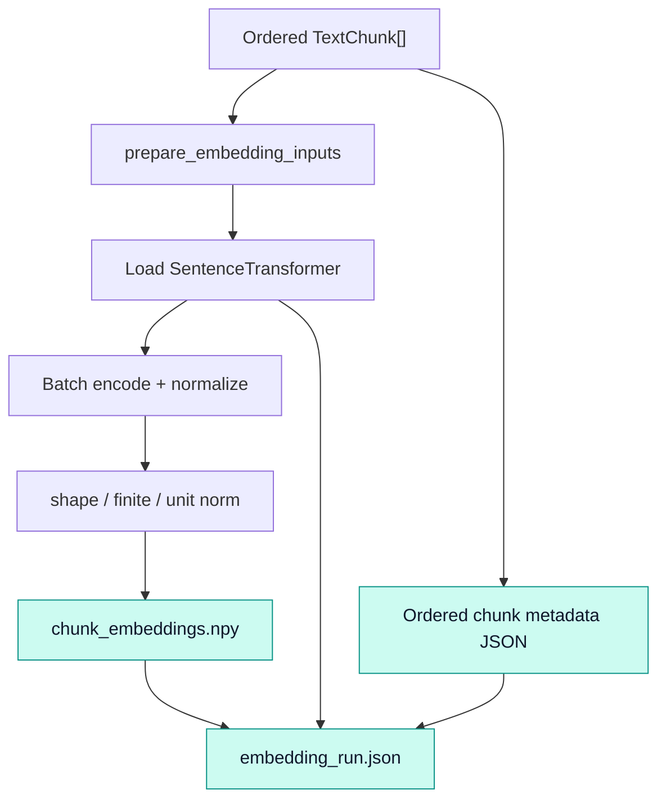
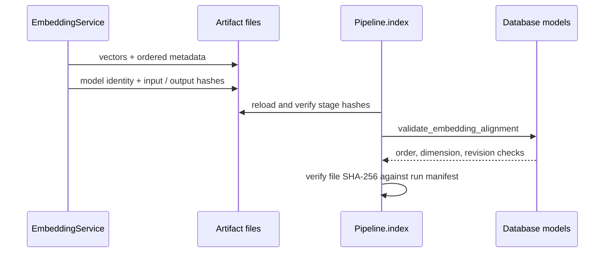

# `embeddings` · Normalized vectors with provenance

[`EmbeddingService`](embedding_service.py) lazily loads a SentenceTransformer, encodes ordered chunks and writes vectors alongside metadata that binds each row to the source text and model revision. Retrieval reuses the same service to encode questions; model identity and expected vector dimensionality are checked against the indexed document. The default configuration uses `sentence-transformers/all-mpnet-base-v2` at **768 dimensions**.

## Encoding and artifact chain

For remote model names `_load_model()` fetches `config.json` from Hugging Face Hub and resolves a 40-character immutable commit identifier, then loads that specific revision. For local model directories the service uses the supplied revision or any available transformer commit metadata; a resolved remote revision is not guaranteed for local files. Device selection is explicit if supplied, else CUDA where available, otherwise CPU.

`encode()` invokes the transformer with configured batch size and `normalize_embeddings=True`. It casts to `float32` and rejects unexpected array shapes, nonfinite values or row norms not approximately equal to one. Empty input to `encode()` is permitted and returns a `(0, dimension)` array; **`embed_chunks()` refuses empty chunks** via `prepare_embedding_inputs()`.

## Index consistency contract

The run manifest records artifact version 2, model name/requested and resolved revisions, dimension, normalization, dtype, ordered chunk-ID hash, text-content digest and vector/metadata SHA-256 hashes. [`Pipeline.index()`](../pipeline.py) combines these with the stage manifest; [`validate_embedding_alignment()`](../database/models.py) also checks the ordered metadata and semantic content digest. These checks are important because row order determines which vector belongs to which chunk.

## Source inventory

| File | Interfaces | Responsibility |
|---|---|---|
| [`embedding_service.py`](embedding_service.py) | `EmbeddingService._load_model`, `model_identity`, `encode`, `embed_chunks` | Model resolution, vector creation and artifact publication |
| [`embedding_service.py`](embedding_service.py) | `prepare_embedding_inputs`, `build_embedding_metadata`, `chunk_id_digest`, `chunk_content_digest` | Ordered input checks and provenance |
| [`__init__.py`](__init__.py) | `EmbeddingService`, metadata/input helpers | Package exports |

**Consumes:** [chunking](../chunking/README.md) output; **used by:** [pipeline](../pipeline.py) indexing and [retrieval](../retrieval/README.md) query encoding. Dependencies include NumPy, PyTorch, `sentence-transformers` and `huggingface_hub`.

> [!IMPORTANT]
> The SQL column is `VECTOR(768)`; a setting change alone cannot migrate it. Model downloads, CUDA availability and reproducibility against a live Hugging Face snapshot were not verified from this archive. `model_identity` is compared at query time to prevent silent embedding-family mismatches.
