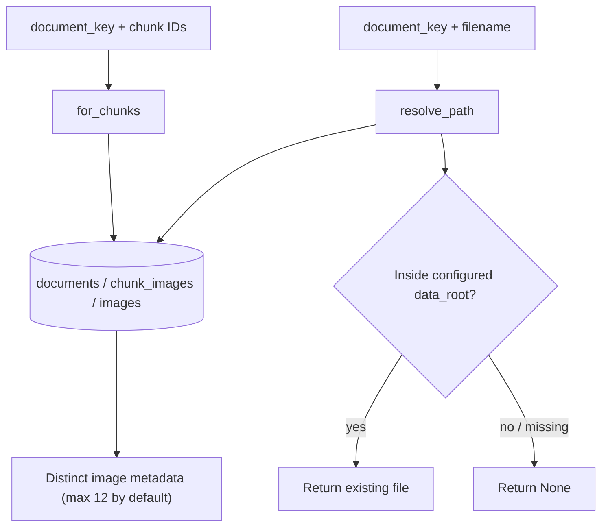

# `images` · Related-image discovery and safe file paths

[`ImageLookup`](image_lookup.py) is the read-side counterpart to [page-based image linking](../linking/README.md). It retrieves image references attached to retrieved chunk IDs and resolves an image's stored path for the API's download endpoint. Image extraction itself belongs to [ingestion](../ingestion/README.md); this package contains no image-generation or computer-vision model.

## Two read paths

`for_chunks()` uses a parameterized SQL join and an `ANY(chunk_ids)` filter scoped by `document_key`. It de-duplicates results with `DISTINCT`, sorts by page and filename, and limits the number returned. The [`RAGService`](../rag/README.md) chooses whether to call this function based on routing or an explicit `include_images` override, and only after a non-rejected grounded answer.

`resolve_path()` looks up the saved path **through document ownership in the DB**, then either accepts an existing path within the configured data root or attempts migration-friendly remapping of a stored `/data/` subtree (including Windows-style separators). In both cases the resolved target must remain inside `data_root`; missing or escaping paths are refused. The HTTP route additionally rejects non-basename filenames and returns a 404 when the file cannot be resolved.

## File map

| File | Important interfaces | Responsibility |
|---|---|---|
| [`image_lookup.py`](image_lookup.py) | `ImageLookup.for_chunks`, `ImageLookup.resolve_path` | Related-image SQL and controlled filesystem resolution |
| [`__init__.py`](__init__.py) | `ImageLookup` | Export |

**Inputs:** indexed `images` and `chunk_images` rows; **outputs:** [`LinkedImage`](../contracts.py) records or a validated `Path`. The [API's image endpoint](../api/README.md) serves the resolved file, not raw arbitrary paths from a request.
