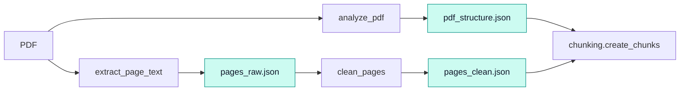
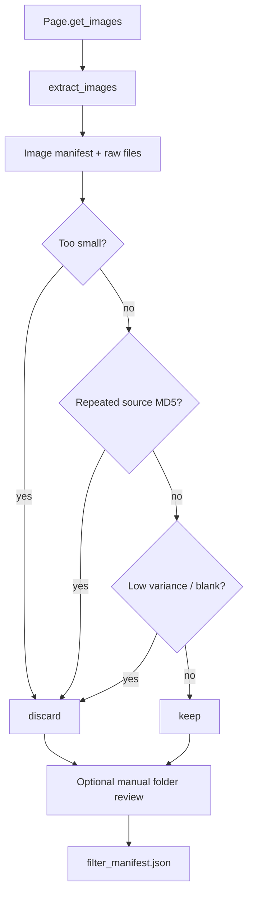

# `ingestion` · PDF extraction and filtering

This package produces the raw inputs for section-aware chunking and optional images. It reads a PDF with PyMuPDF (`fitz`), creates a page/TOC structure record, extracts text as one-based pages and removes configured header/footer lines. Separately, embedded images are exported and filtered by size, duplicates and pixel statistics; it does **not** perform OCR or parse a live SCADA data stream.

## Text branch

`analyze_pdf()` calls `document.get_toc(simple=True)` and records page text counts, empty pages and a heuristic heading-candidate count. The heuristic is diagnostic only: actual chunk boundaries use PDF bookmarks. `extract_page_text()` serializes the original text and page statistics. `clean_page_text()` drops **exact configured** header/footer lines and regex-matched page-number lines, compresses long newline runs and retains `removed_lines` for inspection. It does not remove every possible repeating header automatically.

## Image branch and review

`extract_images()` walks pages/image references in stable order, strips alpha or converts unsuitable color spaces where needed, writes named image files and records dimensions, original-image MD5 and exported byte sizes. Extraction errors are logged and skipped per image. `filter_images()` uses dimensions, first-seen MD5 and grayscale mean/std; blank analysis runs only if no earlier rejection reason exists. It copies files into `filtered/keep` or `filtered/discard` and deletes conflicting stale copies. [`rebuild_manual_review_manifest()`](image_filter.py) reconstructs decisions from the folders, marking absent files `missing` and resolving duplicate folder placement as `keep`.

The [pipeline](../pipeline.py) can retain an existing reviewed manifest **only** if each record matches the latest extraction, carries `source="manual_review"`, has a valid decision and kept/discarded file hashes match the raw image. Otherwise automatic filtering runs. This verifies provenance; it is not an image annotation or semantic-classification model.

## Source inventory

| File | Main functions | Responsibility |
|---|---|---|
| [`pdf_analyzer.py`](pdf_analyzer.py) | `analyze_pdf` | TOC + page structure and heading diagnostics |
| [`text_extractor.py`](text_extractor.py) | `extract_page_text` | One-based raw text/page metadata |
| [`text_cleaner.py`](text_cleaner.py) | `is_header_footer`, `clean_page_text`, `clean_pages` | Configurable line cleanup and audit trail |
| [`image_extractor.py`](image_extractor.py) | `extract_images` | Extract PDF-embedded rasters into a manifest |
| [`image_filter.py`](image_filter.py) | `is_too_small`, `blank_or_solid_reason`, `filter_images`, `rebuild_manual_review_manifest` | Rule-based classification and manual decision reconstruction |
| [`__init__.py`](__init__.py) | Stage-function exports | Convenience imports |

## Contracts and limitations

Outputs use [TypedDict contracts](../contracts.py) (`PdfStructure`, `RawPage`, `CleanPage`, `ImageRecord`, `FilteredImageRecord`) and the atomic JSON writer in [`artifacts.py`](../artifacts.py). [Chunking](../chunking/README.md) consumes structure/clean text; [linking](../linking/README.md) consumes kept-image decisions.

> [!WARNING]
> PDFs without usable bookmarks fail at chunk construction, even if `analyze_pdf()` succeeds. Scanned pages without embedded selectable text require OCR outside this code. `get_images()` addresses embedded images, not every vector drawing or rendered page illustration; filtering can discard small but useful figures.
