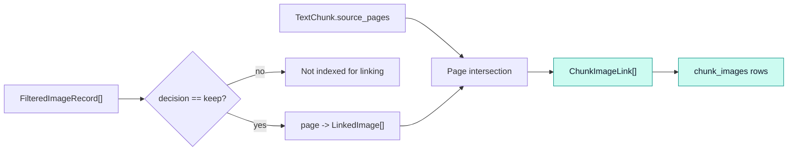

# `linking` · Page-overlap image associations

This package connects kept PDF images to text chunks by their one-based source-page numbers. [`link_images_to_chunks()`](image_text_linker.py) is deterministic: it constructs a `page -> images` lookup and associates every kept image on a page with each chunk that includes that page. It does not compute a semantic image-text similarity score.

## Matching rules

A link record carries `chunk_id`, section title/path, page range, source pages, `image_count` and a list of images (filename, page, dimensions and byte size). Empty-image chunks still receive a record with `image_count = 0`, preserving chunk coverage. The same PDF image can occur in multiple chunk associations when those chunks share a page.

## Source and integration

| File | Interface | Responsibility |
|---|---|---|
| [`image_text_linker.py`](image_text_linker.py) | `link_images_to_chunks` | Deterministic page index, association and optional JSON export |
| [`__init__.py`](__init__.py) | `link_images_to_chunks` | Package export |

**Inputs:** kept images from [ingestion filtering](../ingestion/README.md) and page-aware text chunks from [chunking](../chunking/README.md). **Output:** [`ChunkImageLink`](../contracts.py) records saved to `linked/chunk_image_links.json` when an output path is provided. [Pipeline](../pipeline.py) hashes both input collections for resume validation; [database](../database/README.md) serializes each association with the literal reason `page_overlap`. At question time [image lookup](../images/README.md) fetches linked images by the retrieved chunk IDs.
