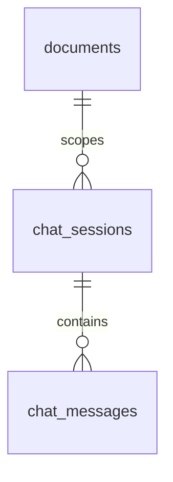
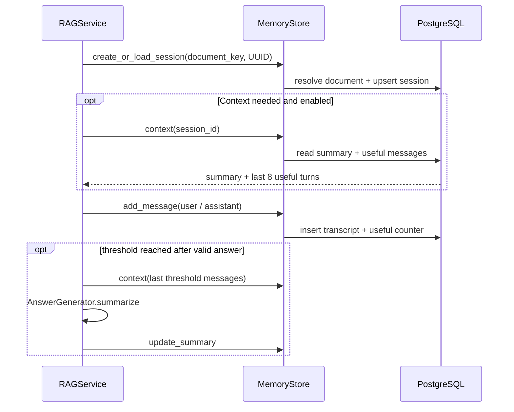

# `memory` · Document-scoped conversation history

This package persists chat sessions and messages in PostgreSQL, optionally supplying a compact summary and recent useful turns to the RAG service. [`MemoryStore`](memory_store.py) ties every session UUID to exactly one indexed document; [`memory_filters.py`](memory_filters.py) identifies trivial messages and explicit requests to ignore prior context. Sessions are persisted across requests, unlike the API ingestion-job registry.

## Session storage

`create_or_load_session()` resolves the document row, creates a new UUID if needed and performs an upsert whose conflict update is allowed only for the same `document_id`; cross-document session reuse raises `ValueError`. `add_message()` persists role, content, citations and a usefulness flag. Useful messages increment a per-session counter. `context()` returns a rolling summary plus recent `is_context_useful = TRUE` rows in chronological order; `messages()` returns recent transcript items regardless of the usefulness flag.

[`RAGService.ask()`](../rag/service.py) creates/loads a session only when `memory_enabled=True` and a retrievable route is pursued. A question requesting fresh context suppresses the context read for that request, although messages may still be persisted when memory is enabled. Valid retrieval answers can trigger summary refresh whenever the useful-message count reaches a multiple of `Settings.memory_summary_threshold` (default `12`); summary-generation failures are logged without discarding the answer. Direct responses returned before the retrieval path are not persisted by this service path.

## File map

| File | Core interfaces | Responsibility |
|---|---|---|
| [`memory_store.py`](memory_store.py) | `create_or_load_session`, `add_message`, `context`, `update_summary`, `messages`, `useful_message_count` | DB-backed session identity, transcript and summary state |
| [`memory_filters.py`](memory_filters.py) | `requests_fresh_context`, `is_context_useful` | Phrase-based context reset and trivial-message detection |
| [`__init__.py`](__init__.py) | `MemoryStore` | Public export |

**Contracts:** `chat_sessions` and `chat_messages` are defined by [database migration](../database/migrations/001_initial.sql); the [API](../api/README.md) exposes history through `GET /sessions/{session_id}/messages`. Summary text is produced by the [RAG answer generator](../rag/answer_generator.py), not by these storage methods.

> [!IMPORTANT]
> `memory_enabled=False` prevents this request's normal session creation, context use and message persistence in `RAGService`; it does not delete existing database history. Memory is document-scoped, not an account-specific private memory system. There is no automatic transcript retention/expiry policy or access-control mechanism in the supplied source.
