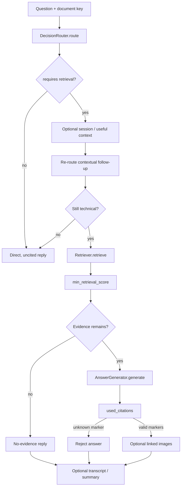
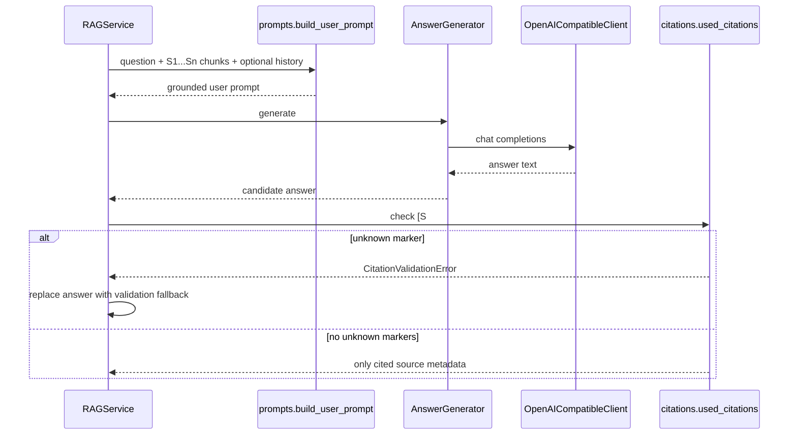

# `rag` · Routed, evidence-grounded answer orchestration

[`RAGService.ask()`](service.py) is the online control path: validate document/request, route the question, optionally resolve conversation context, retrieve matching manual chunks, generate an answer and attach verified source identifiers. [`AnswerGenerator`](answer_generator.py) builds LangChain runnables on top of a small OpenAI-compatible HTTP client; it also summarizes persistent conversation context. No retrieved text is treated as executable commands.

## End-to-end query path

The early router gate avoids model, DB and memory calls for obvious greetings, hostility without a technical request and clearly unrelated questions. One special path allows an otherwise ambiguous follow-up to load existing context before routing again. For retrievable requests, user messages are stored before retrieval (if memory is enabled); a later retrieval or provider failure can therefore leave an unmatched user turn. After retrieval, scored results below the configured minimum are removed and a controlled no-evidence response is emitted when nothing remains.

## Citation and context contract

[`build_context()`](prompts.py) numbers evidence `[S1]`, `[S2]`, etc., with section paths and page ranges. [`used_citations()`](citations.py) extracts single/grouped source markers and rejects markers not associated with the current retrieval set. **Limit:** it does *not* require the model to cite every claim, verify whether a quoted sentence supports the claim, or reject uncited answers. It returns only markers actually found. Image metadata is fetched after citation validation when images were requested or the router marked them useful, and an answer had evidence.

## Implementation map

| File | Important symbols | Responsibility |
|---|---|---|
| [`service.py`](service.py) | `RAGService.from_settings`, `ask` | Integrates router, memory, retriever, generator and image lookup |
| [`answer_generator.py`](answer_generator.py) | `AnswerGenerator._build_chain`, `generate`, `summarize` | LangChain prompt → HTTP model → parsed text chains |
| [`prompts.py`](prompts.py) | `build_context`, `build_user_prompt`, `ANSWER_SYSTEM_PROMPT`, `SUMMARY_SYSTEM_PROMPT` | Numbered excerpts, untrusted-evidence rules and memory context |
| [`citations.py`](citations.py) | `build_citations`, `format_citation`, `used_citations` | Source labels and unknown-marker rejection |
| [`llm_client.py`](llm_client.py) | `OpenAICompatibleClient.chat`, `_endpoint`, `LLMProviderError` | HTTP chat-completions calls, timeout and safe failure mapping |
| [`__init__.py`](__init__.py) | `RAGService` | Public service export |

## Providers, safety and dependencies

The answer client uses `httpx` with the configured URL, key, model, 90-second timeout and JSON chat-completions response. It maps timeouts, rate limits, HTTP failures and malformed provider responses to controlled exceptions, which [FastAPI](../api/README.md) translates into public errors. The LangChain `ChatPromptTemplate`, `RunnableLambda` and `StrOutputParser` compose calls but the HTTP client still owns network I/O.

[`RAGService.from_settings()`](service.py) wires [retrieval](../retrieval/README.md), [router](../router/README.md), [memory](../memory/README.md) and [image lookup](../images/README.md). Settings choose default document, `top_k`, similarity cutoff and summary threshold. Safety-sensitive prompts ask for caution and preservation of manual warnings; they do not establish regulatory certification or safe control execution.

> [!WARNING]
> Answers depend on the indexed manual and an external configured model provider. Prompt instructions discourage hallucination and prompt injection but cannot guarantee either is eliminated. Citation checking is syntactic rather than fact-level verification; industrial/electrical operating decisions still require qualified personnel and approved procedures.
