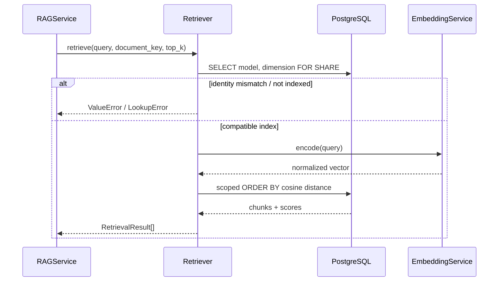
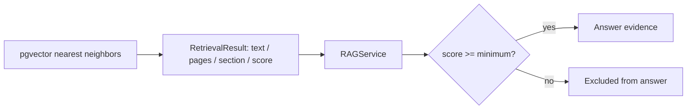

# `retrieval` · Scoped pgvector cosine search

[`Retriever`](retriever.py) translates a technical query into a normalized vector using the same configured [embedding service](../embeddings/README.md) as ingestion. It first verifies the selected document's stored model identity and dimension, then runs a parameterized pgvector cosine-distance query restricted to that document. The RAG layer, rather than this package, applies the minimum similarity threshold.

## Query execution

The similarity value is computed in SQL as `1 - (embedding <=> query_vector)`, where `<=>` is pgvector cosine distance; rows are ordered by distance, then `chunk_index`. Only non-null embeddings and the matching `document_key` are eligible. The requested `top_k` is clamped to `[1, max_top_k]`. Document metadata is selected with `FOR SHARE` inside the same transaction, guarding compatibility while search executes.

## Score paths

The module also provides [`rank_embeddings()`](retriever.py), a **separate NumPy ranking helper** for an in-memory candidate matrix. It validates query/candidate dimensions, computes cosine similarities with a defined `-1` fallback for zero-norm comparisons and uses stable descending sort. It is **not** called by the production `Retriever.retrieve()` SQL path.

## Source files and contracts

| File | Main interfaces | Responsibility |
|---|---|---|
| [`retriever.py`](retriever.py) | `Retriever.retrieve`, `rank_embeddings`, `_json_list` | Model-gated SQL retrieval, optional array ranking and JSONB conversion |
| [`__init__.py`](__init__.py) | `Retriever`, `rank_embeddings` | Public exports |

`retrieve()` yields [`RetrievalResult`](../contracts.py) records containing chunk text, one-based page metadata, section path and score. These go to [RAG prompt construction](../rag/README.md) and optionally [image lookup](../images/README.md). It depends on the database connection/transaction helper, NumPy and the embedding-model runtime.
