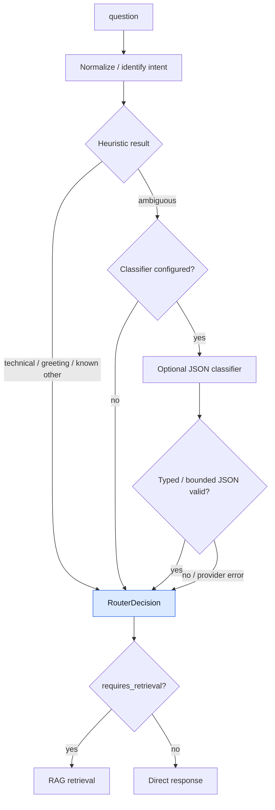
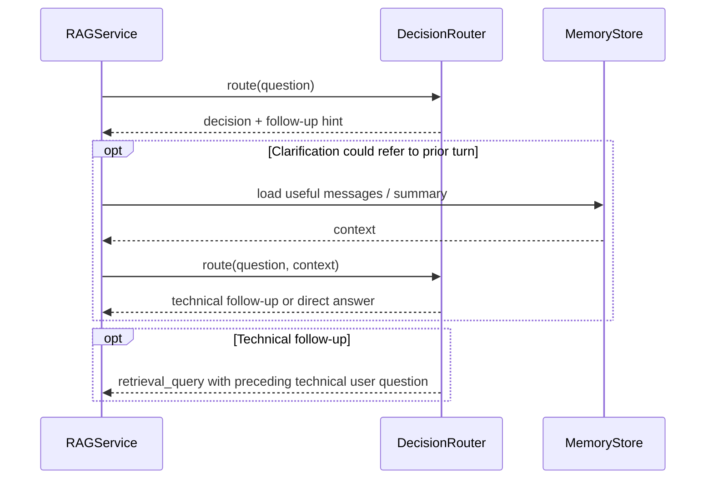

# `router` · Deterministic-first query decisions

[`DecisionRouter`](decision_router.py) decides whether a question needs technical retrieval, a direct response, conversational context or related images. Its default path is rule based, with English/Arabic keyword matching and lightweight follow-up recognition. An **optional** OpenAI-compatible classifier is invoked only when the heuristics leave the message ambiguous; this avoids routine model calls for recognizable requests.

## Decision pipeline

## Follow-up interpretation

`_normalise()` lowercases and strips punctuation, Arabic vowel marks and selected orthographic variants. `_contains_technical()`, `_is_followup()` and `_context_is_technical()` inspect vocabulary and the recent history; `_followup_query()` prepends the most recent technical **user** message to a short follow-up. In `_heuristic()`, recognized technical terms take priority over abusive words, and explicit social / irrelevant / nonsense matches return deterministic responses. Deep procedure vocabulary can raise retrieval depth from `default_top_k` by up to two, capped by `max_top_k`.

The classifier receives [`ROUTER_SYSTEM_PROMPT`](router_prompt.py) requesting JSON with out-of-scope, memory, image, safety, top-k, retrieval query and reason fields. `route()` validates required booleans, integer bounds, string length and nonblank technical queries. Invalid JSON, malformed output or provider failures **fall back** to the heuristic decision. A valid out-of-scope classification uses a safe prewritten response instead of a model-generated answer.

## Source map

| File | Important symbols | Responsibility |
|---|---|---|
| [`decision_router.py`](decision_router.py) | `DecisionRouter.route`, `_heuristic`, `_decision`, `_extract_json`, `is_followup`, `RouterDecision` | Intent, retrieval, memory and image flags; bounded fallback behavior |
| [`router_prompt.py`](router_prompt.py) | `ROUTER_SYSTEM_PROMPT` | Optional classification schema and untrusted-context instruction |
| [`__init__.py`](__init__.py) | `DecisionRouter`, `RouterDecision` | Public exports |

**Output:** `RouterDecision` carries `intent`, `requires_retrieval`, `use_memory`, `needs_images`, `is_followup`, `safety_sensitive`, `top_k`, `retrieval_query`, `reason` and an optional direct response. It is consumed by [`RAGService.ask()`](../rag/service.py). The optional classifier uses [`OpenAICompatibleClient`](../rag/llm_client.py) and is enabled through [`Settings.router_enabled`](../config.py), which defaults to `False`.
