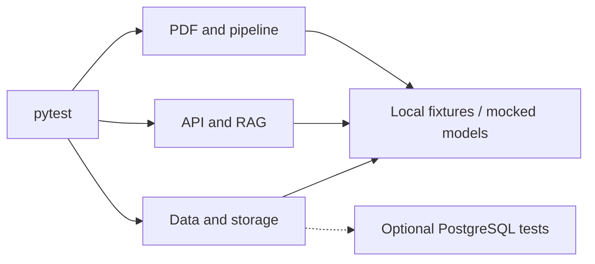

# Tests · Intelligent SCADA Assistant

> **25 test modules** · **96 test functions** (before parametrization) · **pytest**

The test suite checks the main PDF-to-RAG workflow, API behavior, data integrity, and failure handling. Most tests use synthetic PDFs, temporary files, or mocked services; **four database integration tests** require a live PostgreSQL/pgvector instance.

## Test coverage at a glance



## Test file index

| Area | Test files | What they check |
|---|---|---|
| **Configuration & CLI** | [`test_config.py`](test_config.py), [`test_cli.py`](test_cli.py) | Paths, defaults, invalid settings, CLI dispatch |
| **PDF processing** | [`test_pdf_ingestion.py`](test_pdf_ingestion.py), [`test_text_cleaner.py`](test_text_cleaner.py) | PDF analysis, text extraction, cleanup |
| **Chunking & TOC** | [`test_chunking.py`](test_chunking.py), [`test_toc_parser.py`](test_toc_parser.py) | Section boundaries, page references, chunk limits |
| **Images & links** | [`test_image_filter.py`](test_image_filter.py), [`test_linking.py`](test_linking.py), [`test_image_lookup.py`](test_image_lookup.py) | Filtering, chunk-image associations, safe image paths |
| **Artifacts & pipeline** | [`test_artifacts.py`](test_artifacts.py), [`test_pipeline.py`](test_pipeline.py) | Hash-verified resume, provenance checks, corrupted artifacts |
| **Embeddings** | [`test_embeddings.py`](test_embeddings.py) | Ordered inputs, content digests, invalid vectors |
| **Database** | [`test_database_serialization.py`](test_database_serialization.py), [`test_schema_consistency.py`](test_schema_consistency.py), [`test_database_integration.py`](test_database_integration.py) | Serialization, schema consistency, transactions and isolation |
| **Retrieval & citations** | [`test_retrieval.py`](test_retrieval.py), [`test_citations.py`](test_citations.py) | Similarity ordering, model compatibility, citation markers |
| **Routing & answers** | [`test_router.py`](test_router.py), [`test_rag_service.py`](test_rag_service.py) | Routing, evidence thresholds, fallback behavior |
| **Memory** | [`test_memory.py`](test_memory.py) | Session validation, transcript order, useful context |
| **LLM integration** | [`test_llm_client.py`](test_llm_client.py), [`test_langchain_answer_generator.py`](test_langchain_answer_generator.py) | Provider errors and answer-generation wiring |
| **HTTP API & jobs** | [`test_api.py`](test_api.py), [`test_api_jobs.py`](test_api_jobs.py) | Upload validation, endpoint responses, job concurrency |
| **Cross-component flow** | [`test_integration_clean_to_records.py`](test_integration_clean_to_records.py) | Clean text through retrieval-ready records |

## Run the tests

From the **repository root**:

```bash
# Most tests: no live database required
python -m pytest tests/ -m "not database" -q

# Full suite: includes database tests when configured
python -m pytest tests/ -q
```

**Scope:** This page summarizes the uploaded `tests/` archive.
